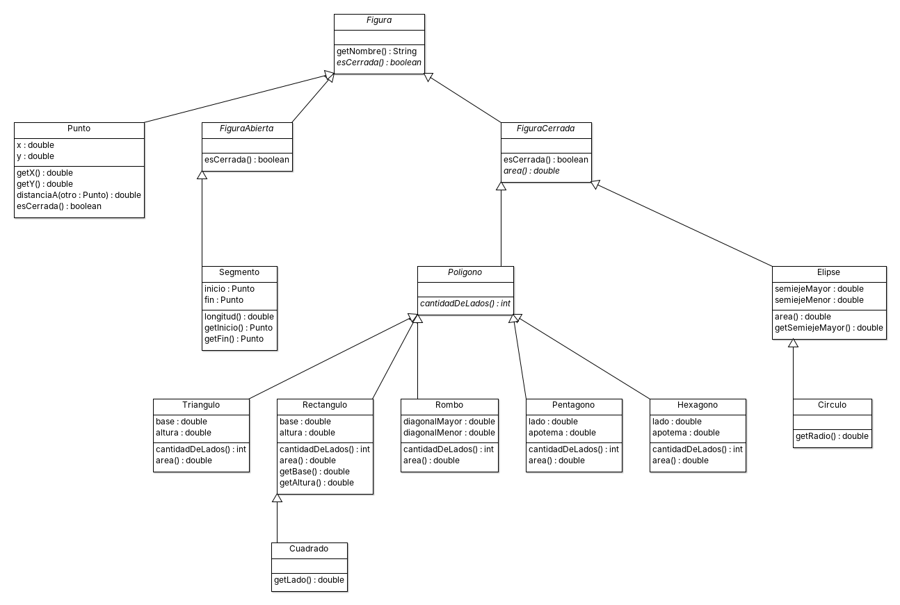

# POO - Actividad 4

**Alumno:** Martín Navarro
**Docente:** Franco Borzi

Ejercicios 2401 a 2408: modelado en ArgoUML, implementación en Java y uso del Java Collection Framework.

## Entrega

- Modelo UML: [`martinnavarro.zargo`](martinnavarro.zargo) (ArgoUML 0.34). Tiene un diagrama de clases por ejercicio (dos para el 2401).
- Código: `src/main/java/edu/programacion/ejercicioXXXX/`
- Tests (JUnit 5): `src/test/java/edu/programacionImpl/`
- Demo de todos los ejercicios: `edu.programacion.Main`

```bash
mvn test                                  # compila y corre los tests
mvn compile exec:java -Dexec.mainClass=edu.programacion.Main   # (o ejecutar Main desde el IDE)
```

## Estructura

```
src/main/java/edu/programacion/
├── Main.java
├── ejercicio2401/   Clases, instancias y jerarquía de figuras
├── ejercicio2402/   Álbum de fotos (AlbumDeFotos, Foto)
├── ejercicio2403/   Convertidor de temperaturas (Temperature, Escala)
├── ejercicio2404/   Editor de figuras (EditorDeFiguras, Figura y subclases)
├── ejercicio2405/   Librería y libros
├── ejercicio2406/   Películas y series
├── ejercicio2407/   Conjuntos de personas
└── ejercicio2408/   Jerarquía de empleados
```

## 2401 - Clases, instancias y jerarquías

### Punto 1: clases e instancias

| Clase | Instancias |
|---|---|
| Universidad | UTN, UNLP, UBA |
| Facultad | Facultad de Derecho, Facultad de Ciencias Exactas |
| Carrera universitaria | Abogacía, Licenciatura en Informática |
| Materia | Programación orientada a objetos, Metodologías de programación, Paradigmas de programación, Redes, BBDD |
| Docente | Natalia Palmieri, Daniela Gratone, Alejandro Ottaviani, Franco Borzi |
| Director | (es una clase; en la lista no aparece ninguna instancia) |
| Lenguaje de programación | Pascal, Smalltalk, Java, C++, Lisp, Python |

### Punto 2: jerarquía de figuras

```
Figura
├── Punto
├── FiguraAbierta
│   └── Segmento
└── FiguraCerrada
    ├── Poligono
    │   ├── Triangulo
    │   ├── Rectangulo
    │   │   └── Cuadrado
    │   ├── Rombo
    │   ├── Pentagono
    │   └── Hexagono
    └── Elipse
        └── Circulo
```

Un cuadrado también es un rombo (tiene los 4 lados iguales), pero Java no permite herencia múltiple de clases, así que se lo ubicó bajo `Rectangulo`.



## 2402 - Álbum de fotos

Las fotos no tienen un lugar fijo y el álbum es "infinito", por eso se usa una `ArrayList<Foto>`, que crece sola. El álbum entiende `agregarFoto`, `agregarFotos(Collection)`, `eliminarFoto`, `limpiar`, `cantidadDeFotos`, `setNombre`, etc.

## 2403 - Convertidor de temperaturas

- `new Temperature()` arranca en 0 °C.
- La temperatura se guarda en **una sola variable, en Celsius**. Los `get`/`set` de Kelvin y Fahrenheit convierten al vuelo, así que pasar un valor en otra escala **no cambia la representación interna**.
- **¿Y si la representación interna pasa a ser Rankine?** Cambia solo el interior de la clase (el atributo y las fórmulas). Los objetos que usan `Temperature` siguen mandando los mismos mensajes (`getCelsius()`, `setKelvin()`...) y no se enteran: eso es encapsulamiento. Para usar Rankine desde afuera alcanza con agregar `getRankine()/setRankine()`.
- **Réaumur:** exactamente lo mismo; se agregan `getReaumur()/setReaumur()` (ya están implementados).
- **Un único método:** `convertTemperature(value, scale, targetScale)` recibe las escalas como el enum `Escala` y convierte pasando siempre por Celsius. Agregar una escala nueva es sumar un valor al enum con sus dos fórmulas.

## 2404 - Editor de figuras

`Figura` es abstracta (todas tienen color y saben `pintar()`, pero cada una calcula `getArea()` a su manera). El editor guarda una `List<Figura>` y aprovecha el polimorfismo en `pintar()` y `calcularArea()`. La `Linea` tiene área 0.

## 2405 - Librería y libros

`Libreria` tiene una `List<Libro>`. `cantidadDeLibros()` cuenta títulos y `cantidadTotalDeCopias()` suma el stock de todos.

## 2406 - Películas y series

`Produccion` (abstracta) junta lo común: título, año, género, actores, directores y personajes. `Pelicula` agrega su duración y `Serie` agrega sus `Capitulo`s (composición). `Actor` y `Director` heredan de `Persona`; cada `Personaje` sabe qué actor lo interpreta. `Catalogo` es el sistema de información.

## 2407 - Conjuntos

`Conjunto` guarda personas en una `ArrayList` y él mismo controla que no haya repetidos (dos personas son iguales si tienen el mismo DNI). Las operaciones no modifican los conjuntos originales, devuelven uno nuevo.

Con A = {Ana, Beto, Carla}, B = {Carla, Dani}, C = {Beto, Eva}:

| Operación | Resultado |
|---|---|
| A ∪ B | {Ana, Beto, Carla, Dani} |
| A ∪ C | {Ana, Beto, Carla, Eva} |
| A ∩ B | {Carla} |
| A ∩ C | {Beto} |
| A − B | {Ana, Beto} |
| A Δ B | {Ana, Beto, Dani} |

## 2408 - Jerarquía de empleados

`Persona` → `Empleado` (abstracta) → `Tecnico` / `Administrativo`. El técnico cobra el monto fijo del contrato; el administrativo cobra `antigüedad * categoría` (categoría de 1 a 4, como dice el enunciado). `Empresa.montoTotal()` suma `getSueldo()` de todos sus empleados sin preguntar de qué tipo es cada uno (polimorfismo).
